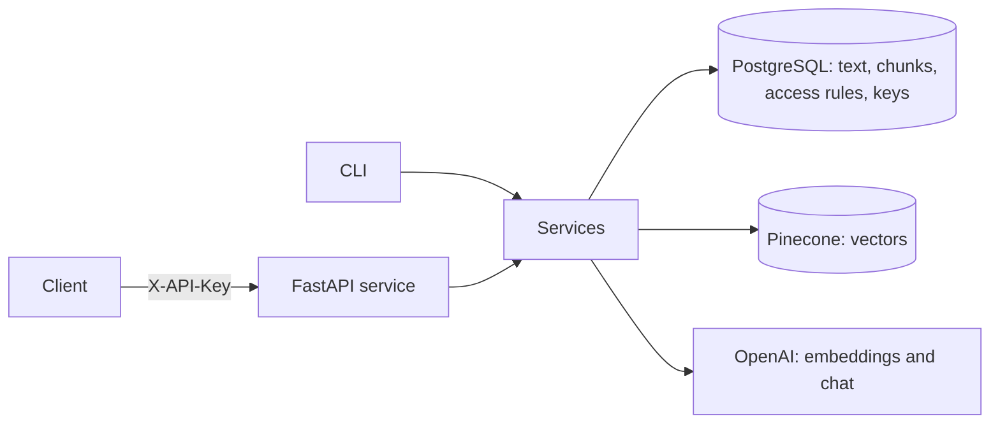
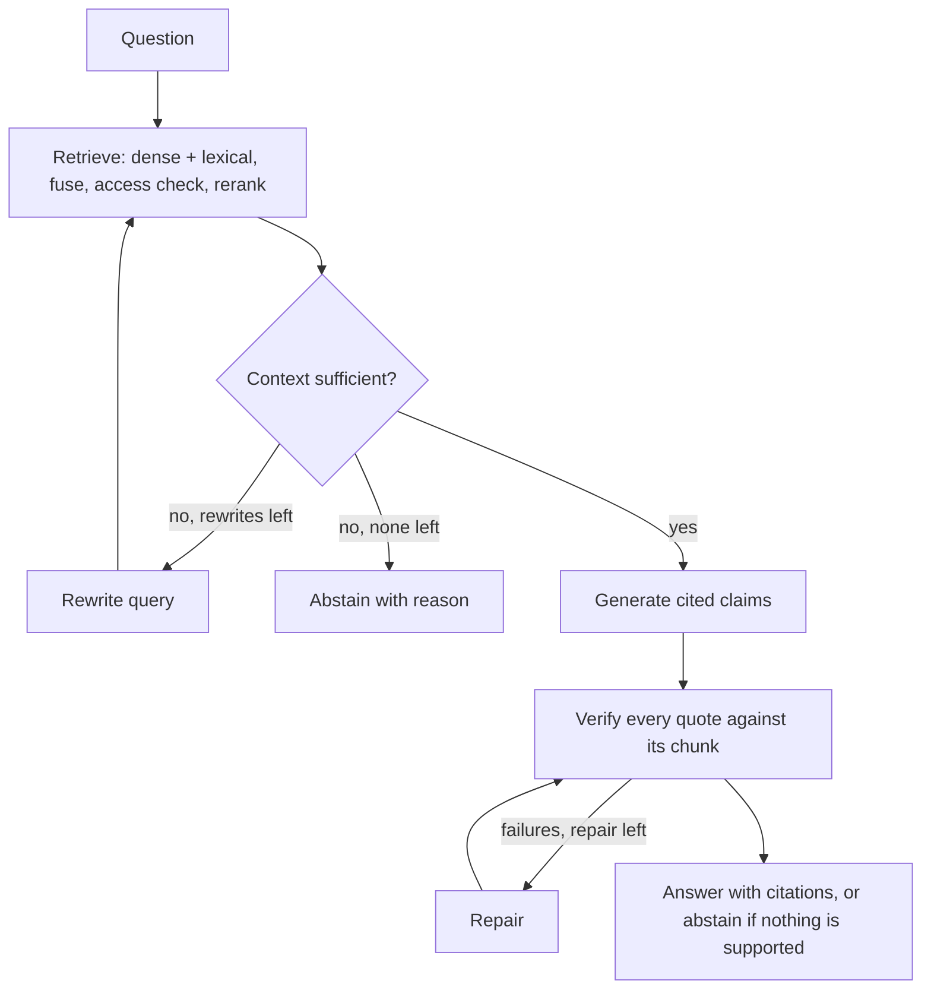

# grounded-rag

Citation-first question answering over private documents, with permission-aware retrieval and an evaluation harness that measures quality, security, latency and cost.

[](https://github.com/hasnatahmadai164/grounded-rag/actions/workflows/ci.yml)
[](LICENSE)
[](pyproject.toml)

## What it does

grounded-rag is a service you can run and operate. You ingest PDF and text documents with a set of roles, create API keys with roles, and ask questions over HTTP or the command line. Each answer comes with citations: verbatim quotes, checked by code against the stored text, with character offsets into the source document. When the documents do not contain enough evidence, the service abstains and says why.

- **Ingestion.** PDF and plain text, structure-aware chunking with character offsets, content-hash ids so ingestion is idempotent, resumable after a failure, safe to repeat for deletion.
- **Hybrid retrieval.** Dense vectors in Pinecone and PostgreSQL full-text search, merged with reciprocal rank fusion, then reranked by a listwise LLM reranker.
- **Permission-aware.** Every document carries `allowed_roles`, every request carries a principal. Access is enforced on the vector query, on the lexical query, and once more against PostgreSQL before anything reaches the model.
- **A bounded agentic loop** in LangGraph: retrieve, grade the context, rewrite the query and retry when the context is insufficient, generate cited claims, verify every citation, repair once, then drop what is unsupported or abstain.
- **Operable.** API-key authentication, health and readiness endpoints, request ids in every response and log line, a per-request usage report (tokens, cost, latency), per-request budgets and timeouts.
- **Measured.** An evaluation harness reports retrieval quality, answer correctness, citation validity, abstention, access-control leakage, latency and cost, with ablations for each component.

Non-goals: multi-tenant billing, a web UI, fine-tuning, OCR for scanned PDFs, multi-language support and streaming answers.

## Results

Numbers in this section are produced by `grounded-rag eval run` and copied here by `scripts/inject_results.py`. See [docs/evaluation.md](docs/evaluation.md) for the method and its limits.

<!-- results:start -->
<!-- results:end -->

## Quickstart with Docker Compose

Requirements: Docker with Compose, an OpenAI API key and a Pinecone API key.

```powershell
Copy-Item .env.example .env
# Edit .env: set OPENAI_API_KEY and PINECONE_API_KEY.

docker compose up --build -d
docker compose run --rm api grounded-rag index create
docker compose run --rm api grounded-rag keys create --name analyst --roles legal
```

The last command prints an API key once. Put some `.pdf`, `.txt` or `.md` files in a `data` folder next to `docker-compose.yml`, then:

```powershell
docker compose run --rm api grounded-rag ingest /data --roles legal
docker compose run --rm api grounded-rag query "Which law governs the agreement?" --as analyst

$headers = @{ "X-API-Key" = "<the key printed above>" }
Invoke-RestMethod -Method Post -Uri http://localhost:8000/v1/query -Headers $headers `
  -ContentType "application/json" -Body '{"question": "Which law governs the agreement?"}'
```

Without Docker for the API, use Python 3.12, a running PostgreSQL 16 and the `DATABASE_URL` from `.env`:

```powershell
pip install -e ".[dev]"
alembic upgrade head
uvicorn grounded_rag.api.app:create_app --factory --port 8000 --no-access-log
```

The model identifiers and prices in `.env.example` are configuration defaults. Check them against your provider account before relying on cost figures. [docs/deployment.md](docs/deployment.md) covers running it for real.

## Architecture





Details, data model and failure behaviour: [docs/architecture.md](docs/architecture.md).

## Configuration

Every setting is an environment variable, read from the environment or a `.env` file. [`.env.example`](.env.example) documents them. Secrets come only from the environment.

| Variable | Default | Purpose |
|---|---|---|
| `LOG_LEVEL` | `INFO` | Log level |
| `LOG_JSON` | `true` | JSON lines (true) or console output (false) |
| `LOG_CONTENT` | `false` | Log raw questions and answers |
| `DATABASE_URL` | local PostgreSQL | SQLAlchemy URL with the asyncpg driver |
| `DATABASE_POOL_SIZE` | `5` | Connections per process |
| `DEFAULT_CORPUS` | `default` | Corpus (Pinecone namespace) used when none is named |
| `OPENAI_API_KEY` | none | OpenAI key |
| `OPENAI_BASE_URL` | `https://api.openai.com/v1` | OpenAI-compatible endpoint |
| `CHAT_MODEL` | `gpt-4o-mini` | Model for grading, rewriting, reranking, answering |
| `EMBEDDING_MODEL` | `text-embedding-3-small` | Embedding model |
| `EMBEDDING_DIMENSIONS` | `1536` | Must equal the Pinecone index dimension |
| `EMBEDDING_BATCH_SIZE` | `96` | Texts per embedding request |
| `LLM_TIMEOUT_SECONDS` | `30` | Timeout of each model call |
| `LLM_MAX_RETRIES` | `3` | Retries for timeouts, 429 and 5xx |
| `LLM_TEMPERATURE` | `0` | Sampling temperature |
| `LLM_SEND_TEMPERATURE` | `true` | Set false for models that reject a temperature |
| `LLM_MAX_OUTPUT_TOKENS` | `1024` | Output limit per call |
| `CHAT_INPUT_USD_PER_MTOK` | `0.15` | Input price, USD per million tokens |
| `CHAT_OUTPUT_USD_PER_MTOK` | `0.6` | Output price, USD per million tokens |
| `EMBEDDING_USD_PER_MTOK` | `0.02` | Embedding price, USD per million tokens |
| `PINECONE_API_KEY` | none | Pinecone key |
| `PINECONE_INDEX_NAME` | `grounded-rag` | Index name |
| `PINECONE_INDEX_HOST` | none | Data-plane host; looked up by name when unset |
| `PINECONE_CLOUD` | `aws` | Cloud for `index create` |
| `PINECONE_REGION` | `us-east-1` | Region for `index create` |
| `PINECONE_API_VERSION` | `2025-01` | API version header |
| `PINECONE_TIMEOUT_SECONDS` | `15` | Timeout of each Pinecone call |
| `PINECONE_MAX_RETRIES` | `3` | Retries for timeouts, 429 and 5xx |
| `CHUNK_TARGET_CHARS` | `1200` | Target chunk size |
| `CHUNK_MAX_CHARS` | `1800` | Largest chunk |
| `CHUNK_MIN_CHARS` | `200` | Smallest chunk that may end at a heading |
| `CHUNK_OVERLAP_CHARS` | `150` | Overlap inside split paragraphs |
| `DEFAULT_TOP_K` | `6` | Passages sent to the model |
| `MAX_TOP_K` | `20` | Largest `top_k` a request may ask for |
| `RETRIEVAL_DENSE_TOP_K` | `30` | Candidates from vector search |
| `RETRIEVAL_LEXICAL_TOP_K` | `30` | Candidates from full-text search |
| `RETRIEVAL_RRF_K` | `60` | Reciprocal rank fusion constant |
| `RETRIEVAL_CANDIDATES` | `20` | Fused candidates kept for reranking |
| `RERANK_ENABLED` | `true` | Rerank with the LLM |
| `AGENT_MAX_REWRITES` | `2` | Query rewrites when context is insufficient |
| `AGENT_MAX_REPAIRS` | `1` | Repair attempts for failed citations |
| `AGENT_MAX_CONTEXT_CHUNKS` | `10` | Passages kept across rewrites |
| `REQUEST_TOKEN_BUDGET` | `60000` | Token ceiling per request |
| `REQUEST_COST_BUDGET_USD` | `0.05` | Cost ceiling per request |
| `REQUEST_TIMEOUT_SECONDS` | `60` | Time limit of `/v1/query` |
| `MAX_REQUEST_BYTES` | `65536` | Largest request body |
| `JUDGE_MODEL` | none | Evaluation judge; defaults to `CHAT_MODEL` |
| `EVAL_CORPUS` | `eval-cuad` | Corpus used by evaluations |
| `EVAL_CACHE_DIR` | `.cache/llm` | Disk cache for evaluation calls |

## API

All `/v1` endpoints need an `X-API-Key` header.

| Endpoint | Purpose |
|---|---|
| `POST /v1/query` | Ask a question. Body: `question` (required), `top_k`, `debug` |
| `GET /v1/documents` | List documents the key's roles may read (`limit`, `offset`) |
| `GET /healthz` | Liveness |
| `GET /readyz` | Readiness: PostgreSQL and Pinecone reachable |

A query response contains `answer` (with `[n]` markers), `abstained`, `abstain_reason`, `citations` (index, `chunk_id`, `doc_id`, document title, section, verbatim `quote`, `start_char`, `end_char`), `usage` (`prompt_tokens`, `completion_tokens`, `embedding_tokens`, `cost_usd`, `latency_ms`), `request_id` and, with `debug`, the retrieval trace with candidates and scores per stage.

Abstention is a normal result with one of the reasons `no_relevant_context`, `insufficient_evidence`, `unsupported_citations` or `budget_exceeded`.

Errors always look like `{"error": {"code": "...", "message": "...", "request_id": "..."}}`. Codes include `missing_api_key`, `invalid_api_key`, `invalid_request`, `payload_too_large`, `llm_error`, `llm_timeout`, `llm_invalid_output`, `vector_store_error`, `dependency_unavailable`, `request_timeout` and `internal_error`.

Command line: `ingest`, `delete`, `query`, `keys create|list|revoke`, `index create`, `eval build-dataset|run|report`. Run `grounded-rag --help`.

## Evaluation

The harness ingests 40 CUAD contracts, asks 14 categories of clause questions (absent clauses are the unanswerable set), and compares five configurations: dense only, lexical only, hybrid, hybrid plus rerank, and hybrid plus rerank plus the retry loop. It reports hit@k, recall@k and MRR, judged correctness, abstention precision and recall, citation verification and judged support, access-control leakage (which must be exactly zero), p50 and p95 latency, tokens and cost per query. Every model call is cached on disk, so reruns are free and reproducible, and `--dry-run` and `--max-cost` keep spending under control.

```powershell
python scripts/fetch_cuad.py
grounded-rag eval build-dataset
grounded-rag eval run --split dev --dry-run
grounded-rag eval run --split test --max-cost 10
python scripts/inject_results.py
```

Method, metrics and the weaknesses of LLM judging: [docs/evaluation.md](docs/evaluation.md).

## Security model

- API keys are random, stored only as hashes, shown once, and revocable.
- Access control is enforced three times; the PostgreSQL check after fusion is authoritative, and a forbidden document behaves exactly like a missing one.
- Retrieved text is treated as data: delimited in prompts, with tag injection defused, no tools for the model, structured outputs, and programmatic verification of every quote.
- Errors do not leak provider detail, logs never contain keys, and questions and answers are not logged unless you opt in.
- Request size, time, tokens and cost are bounded.

Details and limits: [docs/security.md](docs/security.md).

## Repository layout

```
src/grounded_rag/
  domain/       plain data types
  db/           models, repositories, session
  ingestion/    loaders, chunker, embedder, pipeline
  vectorstore/  VectorStore interface, Pinecone adapter
  retrieval/    dense, lexical, fusion, access check, rerank, rewrite, service
  llm/          HTTP transport, chat client, pricing, budget, prompts, disk cache
  agent/        LangGraph graph, nodes, citation verifier, answer service
  api/          app factory, middleware, auth, routes, error mapping
  evals/        dataset, metrics, judge, probes, runner, reports, estimates
migrations/     Alembic
evals/          configs, checked-in question files and reports
scripts/        fetch_cuad.py, inject_results.py
tests/          unit, integration (PostgreSQL), security
docs/           architecture, decisions, evaluation, security, deployment
```

## Limitations

- Scanned PDFs are not supported (no OCR). Documents are expected to be English.
- Only OpenAI and Pinecone are implemented. The vector store sits behind a small interface, but no other backend ships.
- The OpenAI and Pinecone adapters are tested against mock transports, which check request shapes but not the real services. Opt-in checks against the live services exist: `RUN_LIVE=1 pytest -m live` runs them with your keys.
- Roles are flat labels. There is no per-document ownership, audit trail, key expiry or rate limiting.
- Lexical search ranks every matching chunk, which suits corpora of thousands of chunks, not millions.
- Vectors cannot be rebuilt from the stored text with a command; re-ingest the files after losing an index.
- Answers are grounded in quotes, but a model can still misread a quote. The evaluation reports how often.
- LLM judging is imperfect. See the evaluation document before drawing conclusions from small differences.

## Contributing

See [CONTRIBUTING.md](CONTRIBUTING.md). Run `ruff check .`, `ruff format --check .`, `mypy --strict src` and `pytest` before opening a pull request.

## License

MIT. See [LICENSE](LICENSE). The CUAD dataset used by the evaluation is distributed under its own license; see [docs/evaluation.md](docs/evaluation.md).

## Author

Hasnat Ahmad. GitHub: [hasnatahmadai164](https://github.com/hasnatahmadai164). LinkedIn: [hasnat-ahmad-ai](https://www.linkedin.com/in/hasnat-ahmad-ai/).
